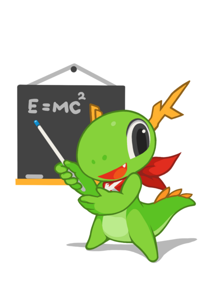

  
Clase 1 · Fundamentos de Linux

  
Rocket Tech Academy

  

    

      <h1 class="hero-title">Primer contacto con Linux</h1>
      
Software libre, distribuciones, entornos de práctica y primeros comandos desde la terminal.

      

        
¿Qué es Linux y dónde se usa?

        
Historia, distribuciones y arquitecturas

        
Gaming en Linux: SteamOS y Proton

        
Entornos de práctica y primer comando

      

    

    

      

        
        
Prof. David A. Robles Vargas

        
Estudiante de Ciencias de la Computación y Guitarra Clásica

        
Instituto Tecnológico de Costa Rica

        

          

darobles@proton.me

          

86329326

          

darobles.49

        

      

    

  

  

  

---

  

  

  
Historia · 1991 en adelante

  <h2 class="slide-title">De un proyecto de estudiante a todas partes</h2>
  

    

      
1983

      
Richard Stallman funda el proyecto GNU

    

    

      
1991

      
Linus Torvalds publica el primer kernel Linux

    

    

      
1990s

      
GNU + Linux + distribuciones: nace el ecosistema

    

    

      
2000s–hoy

      
De servidores a Android, la nube y el escritorio

    

  

---

  

  

  
Para arrancar

  <h2 class="slide-title">¿Qué es Linux, realmente?</h2>
  

    
KernelEl núcleo: gestiona hardware, procesos y memoria

    
BootloaderQué arranca antes que el sistema (GRUB, systemd-boot)

    
Desktop EnvironmentLa interfaz gráfica: GNOME, KDE Plasma, XFCE...

    
Gestor de paquetesCómo se instala y actualiza software

  

---

  

  

  
Módulo 1 · Distribuciones

  <h2 class="slide-title">Un kernel, muchos sabores</h2>
  
Cada distribución empaqueta el kernel con sus propias herramientas, filosofía y público.

  

    

Ubuntu

    

Linux Mint

    

Zorin OS

    

Fedora

    

Debian

    

Red Hat

    

CachyOS

    

Bazzite

    

SteamOS

  

---

  

  

  
Cómo elegir una distro

  <h2 class="slide-title">Modelos de lanzamiento y arquitecturas</h2>
  

    

      <h3>Modelos de lanzamiento</h3>
      <ul>
        <li>Estable</li>
        <li>LTS (soporte extendido)</li>
        <li>Rolling release</li>
      </ul>
    

    

      <h3>Arquitecturas</h3>
      <ul>
        <li>x86 / x86_64</li>
        <li>ARM</li>
        <li>Otras arquitecturas actuales</li>
      </ul>
    

  

---

  

  

  
Presencia actual

  <h2 class="slide-title">¿En dónde vive Linux hoy?</h2>
  
Respuesta corta: en todo.

  

    
Servidores y la nubeLa gran mayoría de internet corre sobre Linux

    
AndroidUn kernel Linux debajo de todo

    
Sistemas embebidosRouters, TVs, electrodomésticos

    
Clústeres de alto rendimiento (HPC)Prácticamente el 100% del Top500 mundial

  

---

  

  

  
¿Diferentes sistemas operativos?

  <h2 class="slide-title">Linux y BSD</h2>
  

    

      Licencia GPL
      <h3>Linux</h3>
      <ul>
        <li>Copyleft: las modificaciones deben compartirse</li>
        <li>Enorme ecosistema de distribuciones</li>
      </ul>
    

    

      Licencia BSD
      <h3>FreeBSD y familia</h3>
      <ul>
        <li>Permisiva: se puede modificar sin publicar el código</li>
        <li>Atractiva para productos comerciales cerrados</li>
      </ul>
    

  

  
<strong>Dato curioso:</strong> la Switch usa parte del código de BSD, pero el kernel (Horizon) es propio de Nintendo.

---

  

  

  
Formas de interactuar

  <h2 class="slide-title">GUI vs CLI</h2>
  

    

      <h3>GUI</h3>
      <ul>
        <li>Interfaz gráfica de usuario</li>
        <li>Intuitiva, visual</li>
        <li>Limitada para automatizar</li>
      </ul>
    

    

      <h3>CLI</h3>
      <ul>
        <li>Interfaz de línea de comandos</li>
        <li>Uso de recursos reducido</li>
      </ul>
    

  

---

  
Gaming en Linux

  
¿Por qué SteamOS no es la solución al gaming en Linux?

---

  

  

  
¿Es Wine un emulador?

  <h2 class="slide-title">Proton: correr juegos de Windows en Linux</h2>
  

    
WineCapa de compatibilidad: traduce llamadas de Windows a Linux

    
ValveLa empresa detrás de Steam y del impulso al gaming en Linux

    
ProtonLa versión de Wine de Valve, optimizada para juegos

  

---

  

  

  
¿Cuál es el panorama?

  <h2 class="slide-title">Drivers gráficos: AMD, NVIDIA e Intel</h2>
  

    

      <h3>Drivers de código abierto</h3>
      <ul>
        <li>Mesa · implementación abierta de OpenGL/Vulkan</li>
        <li>Nouveau · driver libre para tarjetas NVIDIA</li>
      </ul>
    

    

      <h3>Fabricantes</h3>
      <ul>
        <li>AMD · buen soporte open source</li>
        <li>Intel · integrado, buen soporte open source</li>
        <li>NVIDIA · históricamente más cerrado</li>
      </ul>
    

  

---

  

  

  
Preparando el entorno

  <h2 class="slide-title">Virtualización: nuestra herramienta de práctica</h2>
  
Se permite cualquier máquina virtual (VM) en el curso.

  

    

      Recomendada
      <h3>Hyper-V</h3>
      <ul>
        <li>Hipervisor tipo 1: corre directo sobre el hardware</li>
        <li>Integrado en Windows, sin instalar nada extra</li>
        <li>Buena integración con WSL2</li>
      </ul>
    

    

      También válida
      <h3>VirtualBox</h3>
      <ul>
        <li>Hipervisor tipo 2: corre sobre el sistema operativo</li>
        <li>Multiplataforma y gratuito</li>
        <li>No convive bien con Hyper-V activo</li>
      </ul>
    

  

---

  

  

  
Confianza en lo que descargas

  <h2 class="slide-title">Verificación de integridad</h2>
  
Antes de instalar cualquier distro comprobamos que el archivo no fue alterado — la primera vez lo haremos desde Windows.

  

    

      
 Windows PowerShell

      

        
−

        
▢

        
×

      

    

    

      
PS C:\Users\diblo&gt; Get-FileHash .\ubuntu-24.04.iso -Algorithm SHA256

      
Algorithm  Hash                                                              Path

      
---------  ----                                                              ----

      
SHA256     A1B2C3D4E5F6A1B2C3D4E5F6A1B2C3D4E5F6A1B2C3D4E5F6A1B2C3D4E5F6A1B2  ubuntu-24.04.iso

    

  

---

  

  

  
Primer comando

  <h2 class="slide-title">uname: preguntándole al sistema quién es</h2>
  

    

      
bash — konsole

      

        
−

        
▢

        
×

      

    

    

      

        
❯ uname -a

        
Linux dicachy 7.1.2-1-cachyos-bore #1 SMP PREEMPT_DYNAMIC x86_64 GNU/Linux

      

      

        
❯ uname -r

        
7.1.2-1-cachyos-bore

      

      

        
❯ uname -m

        
x86_64

      

    

  

  
<strong>Nota:</strong> esos guiones con letra (<code>-a</code>, <code>-r</code>, <code>-m</code>) se llaman <em>flags</em>. Se van a ver con mayor detalle en próximas clases.

---

  
¿Preguntas?

  
Rocket Tech Academy · Fundamentos de Linux

